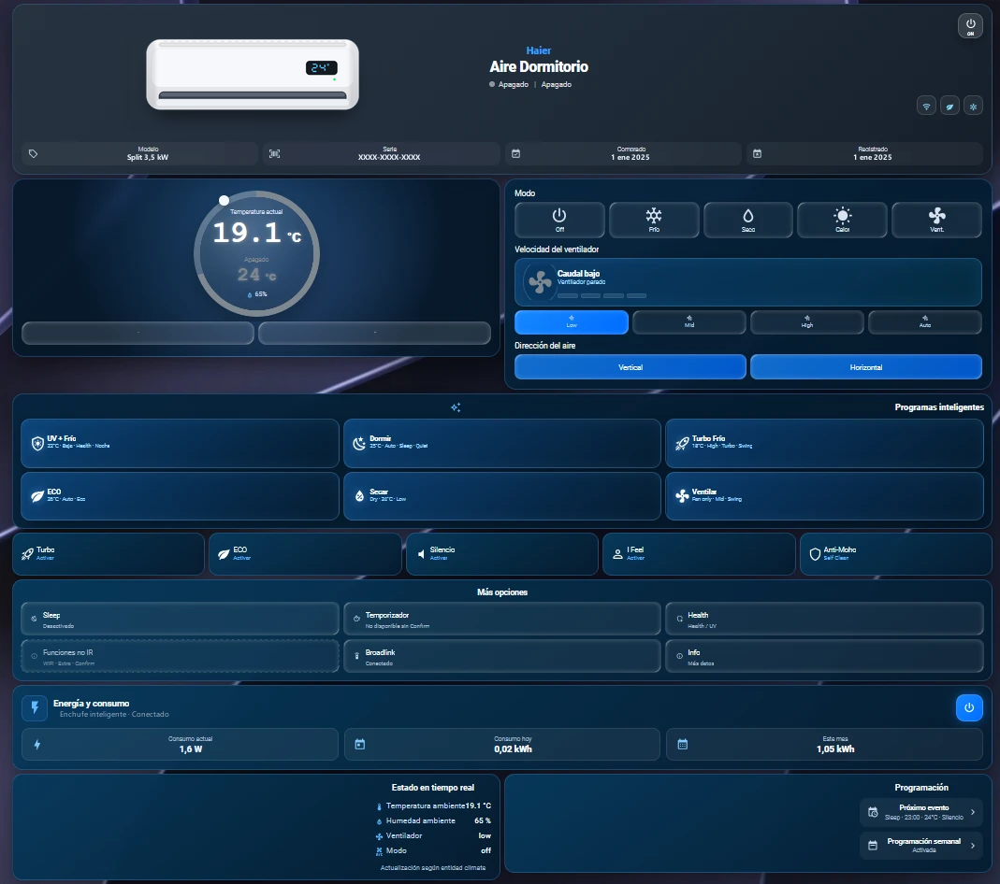

# ❄️ Haier Premium Dashboard for Home Assistant

[Versión en español](README_ES.md)

A modern, dark, animated dashboard to control a **Haier air conditioner over infrared** with a
**Broadlink** and **SmartIR** in Home Assistant. It works with any split unit SmartIR can drive — just
change the "Haier" text and the picture.

> Unofficial project. Not affiliated with or endorsed by Haier. "Haier" is only used to name the unit it
> was tested with.

> ℹ️ The dashboard labels are in Spanish. They are plain text in the YAML, easy to translate.

  

## ✨ Features

- **Header** with unit picture, status (On/Off · mode), ON/OFF button and unit details.
- **Round thermostat** with current temperature, target, humidity and − / + buttons; colour follows the mode.
- **Modes**: Off, Cool, Dry, Heat and Fan.
- **Fan**: Low / Mid / High / Auto, with an icon that spins faster or slower and a level bar.
- **Air direction**: vertical and horizontal swing (IR commands).
- **6 smart programs** (scripts): UV + Cool, Sleep, Turbo Cool, ECO, Dry and Fan.
- **Quick IR functions**: Turbo, ECO, Quiet, I Feel and Anti-mould (self clean).
- **Energy** (optional) with a smart plug that measures power: current power, today and this month,
  with warning colours above 800 W and 1500 W.
- **Live status** and schedule card.
- Works on **phone, tablet and desktop**.

## 📦 Requirements

| You need | For |
|---|---|
| Home Assistant 2024.8 or newer | *sections* views and `action:` in scripts |
| [button-card](https://github.com/custom-cards/button-card) (HACS) | Every card in the dashboard |
| A **Broadlink** (RM4 mini, RM4 pro…) with the official integration | Sending IR codes |
| [SmartIR](https://github.com/smartHomeHub/SmartIR) (HACS) | The AC `climate` entity |
| Smart plug with power metering (optional) | Energy card |

## 🚀 Quick install

1. Install **button-card** and **SmartIR** from HACS and set up your AC in SmartIR.
2. Learn the extra IR codes on the Broadlink → [docs/BROADLINK.md](docs/BROADLINK.md).
3. Copy `www/haier/haier_split_dashboard.png` to `/config/www/haier/` (create the folder if needed).
4. Paste the scripts from [`scripts/haier_scripts.yaml`](scripts/haier_scripts.yaml) into your `scripts.yaml`.
5. Create a new dashboard and paste [`dashboard/haier-premium.yaml`](dashboard/haier-premium.yaml) into the raw configuration editor.
6. Replace the placeholders `climate.TU_AIRE`, `remote.TU_BROADLINK`… with your entities → [docs/ENTITIES.md](docs/ENTITIES.md).

Step-by-step guide (Spanish): **[docs/INSTALLATION.md](docs/INSTALLATION.md)**.

## 🛠️ Troubleshooting

| Symptom | Fix |
|---|---|
| Red cards "Custom element doesn't exist: button-card" | Install button-card from HACS and hard-reload the browser (Ctrl+F5). |
| Unit picture missing | Check it is in `/config/www/haier/`; restart HA if the `www` folder did not exist before. |
| A button does nothing | The IR command is not learned or has another name. Test it in *Developer tools → Actions* with `remote.send_command`. |
| State does not match the unit | Normal with IR: the AC does not report back. Use the dashboard instead of the original remote. |

## ☕ Support

If this helped you, you can buy me a coffee ☕ (or use the **💗 Sponsor** button at the top of the repo). Thank you!

[MIT](LICENSE) license.
