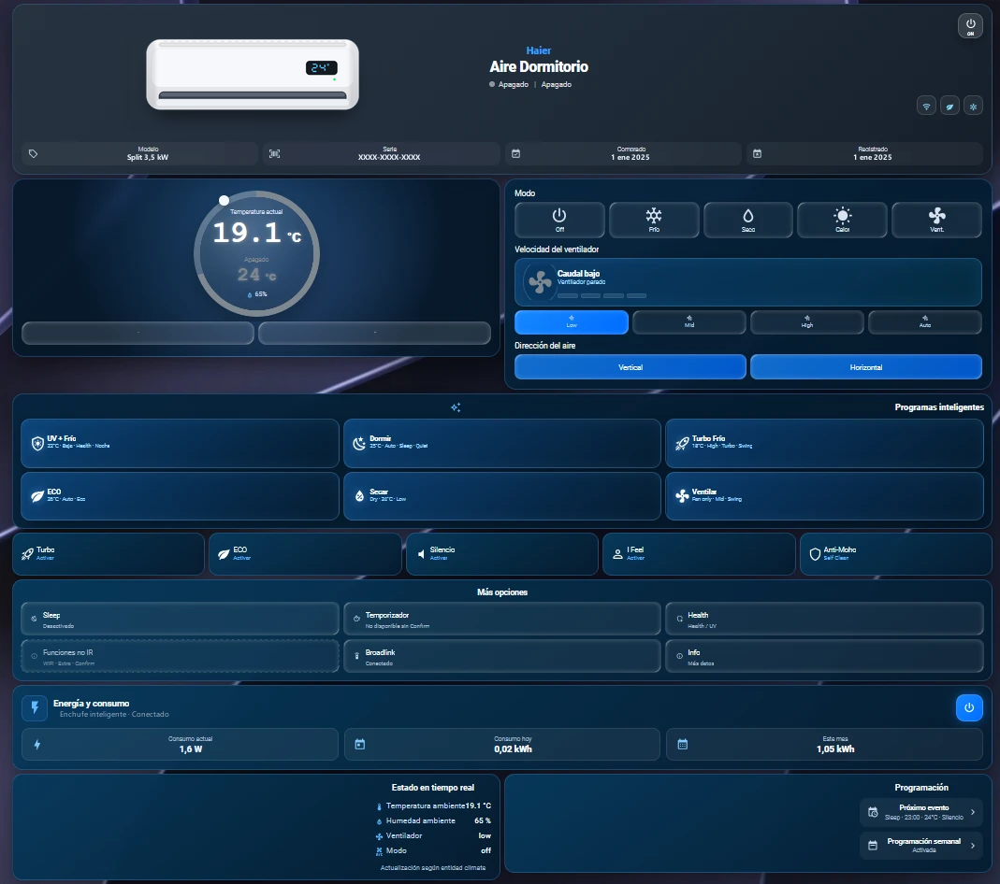

# ❄️ Haier Premium Dashboard para Home Assistant

[English version](README.md)

<a href="https://www.paypal.com/ncp/payment/KKLS7UVFFSNZE"></a>

Panel moderno, oscuro y animado para controlar un **aire acondicionado Haier por infrarrojos** con un
**Broadlink** y **SmartIR** desde Home Assistant. Funciona con cualquier split que SmartIR controle; solo
cambia el texto «Haier» y la imagen.

> Proyecto no oficial. No está afiliado ni respaldado por Haier. «Haier» se usa solo para indicar el
> aparato con el que se ha probado.

<p align="center">
  
</p>

## ✨ Qué incluye

- **Cabecera** con imagen del split, estado (Encendido/Apagado · modo), botón ON/OFF y ficha del equipo.
- **Termostato circular** con temperatura actual, objetivo, humedad y botones − / +; cambia de color según el modo.
- **Modos**: Off, Frío, Seco, Calor y Ventilador.
- **Ventilador**: Low / Mid / High / Auto, con icono que gira más o menos rápido y barra de nivel.
- **Dirección del aire**: oscilación vertical y horizontal (comandos IR).
- **6 programas inteligentes** (scripts): UV + Frío, Dormir, Turbo Frío, ECO, Secar y Ventilar.
- **Funciones rápidas por IR**: Turbo, ECO, Silencio, I Feel y Anti-moho (autolimpieza).
- **Energía y consumo** (opcional) con un enchufe inteligente con medición: potencia actual, hoy y este mes,
  con colores de aviso a partir de 800 W y 1500 W.
- **Estado en tiempo real** y tarjeta de programación.
- Adaptado a **móvil, tablet y escritorio**.

## 📦 Requisitos

| Necesitas | Para qué |
|---|---|
| Home Assistant 2024.8 o superior | Vistas de tipo *sections* y `action:` en scripts |
| [button-card](https://github.com/custom-cards/button-card) (HACS) | Todas las tarjetas del panel |
| Un **Broadlink** (RM4 mini, RM4 pro…) con la integración oficial | Enviar los códigos IR |
| [SmartIR](https://github.com/smartHomeHub/SmartIR) (HACS) | La entidad `climate` del aire |
| Enchufe con medición de consumo (opcional) | Tarjeta de energía |

## 🚀 Instalación rápida

1. Instala **button-card** y **SmartIR** desde HACS y configura tu aire en SmartIR.
2. Aprende los códigos IR extra en el Broadlink → [docs/BROADLINK.md](docs/BROADLINK.md).
3. Copia `www/haier/haier_split_dashboard.png` a `/config/www/haier/` (crea la carpeta si no existe).
4. Pega los scripts de [`scripts/haier_scripts.yaml`](scripts/haier_scripts.yaml) en tu `scripts.yaml`.
5. Crea un panel nuevo y pega [`dashboard/haier-premium.yaml`](dashboard/haier-premium.yaml) en el editor de configuración en bruto.
6. Sustituye los marcadores `climate.TU_AIRE`, `remote.TU_BROADLINK`… por tus entidades → [docs/ENTITIES.md](docs/ENTITIES.md).

Guía paso a paso: **[docs/INSTALLATION.md](docs/INSTALLATION.md)**.

## 📁 Estructura

```
haier-premium-dashboard/
├── dashboard/haier-premium.yaml   # el panel (con marcadores)
├── scripts/haier_scripts.yaml     # los 6 programas inteligentes
├── www/haier/haier_split_dashboard.png
└── docs/                          # instalación, entidades y Broadlink
```

## 🛠️ Problemas frecuentes

| Síntoma | Solución |
|---|---|
| Tarjetas rojas «Custom element doesn't exist: button-card» | Instala button-card desde HACS y recarga el navegador (Ctrl+F5). |
| No se ve la imagen del split | Comprueba que está en `/config/www/haier/` y reinicia HA si la carpeta `www` no existía. |
| Un botón no hace nada | El comando IR no está aprendido o tiene otro nombre. Mira *Herramientas para desarrolladores → Acciones* con `remote.send_command`. |
| El estado no coincide con el aparato | Normal con IR: el aire no informa de su estado. Usa los botones del panel en vez del mando original, o añade un sensor de temperatura/consumo. |

## ☕ Apoya el proyecto

Si te ha servido, puedes invitarme a un café 💙 (o usar el botón **💗 Sponsor** de arriba del repositorio). ¡Gracias!

<a href="https://www.paypal.com/ncp/payment/KKLS7UVFFSNZE"></a>

Licencia [MIT](LICENSE).
